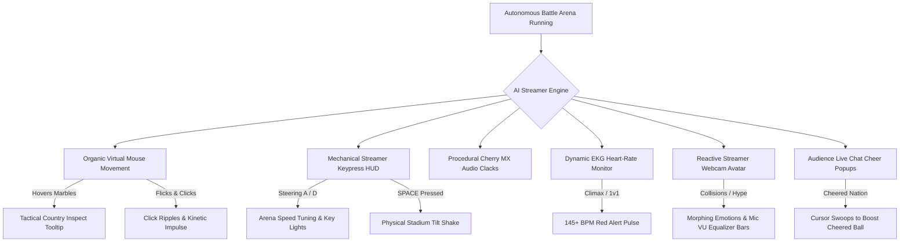
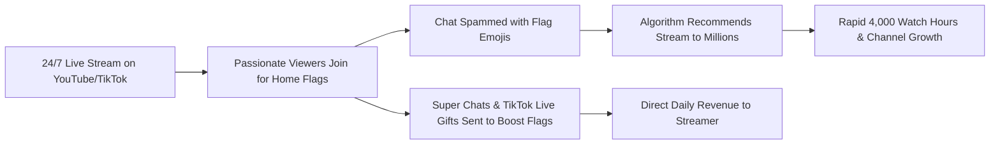
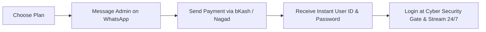

# 🎮 Country Flag Battle Royale 24/7
### The Ultimate Autonomous Esports Battle Royale Simulator for YouTube Live & TikTok (9:16 Vertical Stream)

[-00e5ff?style=for-the-badge)](https://countryflagbattlegame.vercel.app/)

 

🌐 **Play Live Now Online**: **[https://countryflagbattlegame.vercel.app/](https://countryflagbattlegame.vercel.app/)**

**Country Flag Battle Game (195 Country Flag Battle Royale)** is a world-class, automated 24/7 live-streaming simulation game built specifically for content creators, gaming channels, and TikTok/YouTube Live streamers. Created and developed by **Md Talha Hussain Tawhid**, featuring real-time **Matter.js 2D rigid-body physics**, dual-tier high-definition vector flag rendering, copyright-safe procedural Web Audio synthesis, and dynamic spectator leaderboards — ready to play free online or broadcast straight out of the box in OBS Studio and Streamlabs.

---

## 📌 Table of Contents
1. [🌟 Highlights & Features](#-highlights--features)
2. [🧑‍💻 AI Human Streamer Simulation Engine (Anti-Bot System)](#-ai-human-streamer-simulation-engine-anti-bot-system)
3. [💰 Creator Monetization & Stream Growth Playbook](#-creator-monetization--stream-growth-playbook)
4. [💼 Custom Game & Website Development (Hire Developer)](#-custom-game--website-development-hire-developer)
5. [🚀 How to Use & Broadcast (OBS Setup Guide)](#-how-to-use--broadcast-obs-setup-guide)
6. [⚙️ Streamer Drawer & Controls](#️-streamer-drawer--controls)
7. [💎 Subscription Plans & Pricing](#-subscription-plans--pricing)
8. [🛒 How to Purchase & Activate Your License](#-how-to-purchase--activate-your-license)
9. [🔒 Cyber Security Gate & Anti-Piracy Protection](#-cyber-security-gate--anti-piracy-protection)
10. [🔍 Google Search Keywords & SEO Optimization](#-google-search-keywords--seo-optimization)
11. [❓ Frequently Asked Questions (FAQ)](#-frequently-asked-questions-faq)
12. [📞 Official Support & Developer Contact](#-official-support--developer-contact)

---

## 🌟 Highlights & Features

* 🧑‍💻 **Autonomous Human Gameplay Simulation System**: Organic Bezier virtual mouse cursor with country inspect badges, real-time keypress HUD (`[A]`, `[D]`, `[SPACE: TILT]`, `[🖱️ FLICK]`), dynamic EKG heart-rate monitor (78-150 BPM), reactive cyberpunk streamer webcam avatar with animated microphone VU meters, and synthetic mechanical keyboard audio.
* 🎪 **High-Octane Rotating Battle Arena**: Circular battle colosseum powered by Matter.js rigid-body physics with motor-driven kinetic flippers, bouncy neon pinball bumpers, and dynamic hazard gates.
* 🏳️ **Dual-Tier Pro Flag Engine**: Procedural vector flag generator combined with official FlagCDN high-res textures for over 190+ nations worldwide.
* 🔮 **3D Glossy Championship Marbles**: Specular light glints, metallic championship rims, and country name labels for crystal-clear spectator visibility on mobile screens.
* ⚔️ **Esports 1v1 Final Showdown Stinger**: Dramatic split-screen entrance banner with flame & cyan lightning effects and sub-bass impact audio when only 2 countries remain.
* 🏆 **Royal Victory Podium Celebration**: Golden sunburst particle bursts, laurel wreath crest, 3D animated golden crown, and an automated 7-second circular intermission countdown.
* 🎵 **100% Copyright-Free Web Audio Synthesizer**: Zero risk of YouTube Content-ID strikes or stream mutes! Real-time Web Audio API synthesis produces bumper pops, kinetic bounces, heartbeat tension pulses, and victory fanfares.
* 📱 **Native 9:16 Vertical Esports HUD**: Designed from the ground up for YouTube Shorts, YouTube Vertical Live, TikTok Live, and Facebook Reels.

---

## 🧑‍💻 AI Human Streamer Simulation Engine (Anti-Bot System)

> ### 🛡️ The Secret to 24/7 Channel Growth & Monetization Safety
> Modern live streaming platforms (YouTube Live, TikTok Live, Twitch) strictly demote unattended robotic loops, pre-recorded videos, and static bot games under their **"Repetitive, Automated, or Low-Effort Content"** policies.
> 
> **Country Flag Battle Royale 24/7** solves this completely by integrating an advanced **AI Human Streamer Simulation Engine**. Even when you are sleeping or away from your computer, the broadcast autonomously acts, moves, and reacts exactly like a live human content creator actively playing at their desk!

### 🧩 6 Core Human Streamer Components:

1. **🖱️ Virtual Human Mouse Cursor & Target HUD**:
   * Uses organic Bezier curves and micro-jitters to mimic human wrist movements instead of robotic straight lines.
   * Periodically hovers over prominent marbles to display tactical country info badges (e.g. `🎯 TARGET: BANGLADESH [14 WINS]`).
   * Executes periodic clicks with expanding neon ripples and imparts subtle flick impulses to nearby marbles.

2. **⌨️ Streamer Keypress HUD & Manual Control Overlay**:
   * Broadcast-grade glassmorphic controller overlay displaying `[◀ A]`, `[D ▶]`, `[SPACE: TILT]`, and `[🖱️ FLICK]`.
   * The keys illuminate in real time when the streamer steers the arena or triggers stadium shakes.
   * **Full Manual Play Support**: You can also physically press `A`, `D`, `SPACE`, or click on the canvas with your real mouse anytime to play along with your audience!

3. **💓 Real-Time EKG Heart-Rate Monitor**:
   * Displays an animated electrocardiogram line wave with live numeric BPM.
   * Smoothly transitions from peaceful baseline (76-84 BPM) during regular rounds to an intense, pulsating red alert (136-152 BPM) during 1v1 Final Showdowns!

4. **👤 Reactive Streamer Facecam Avatar & Microphone VU**:
   * Cyberpunk gamer webcam frame in the top-right corner with a `🔴 LIVE CAM` indicator.
   * Features natural eye blinking, morphing emotional facial expressions (Calm, Focused, Shocked upon eliminations, and Cheering upon victory).
   * 8-band animated microphone VU equalizer bars bounce in sync with audio collisions, giving the impression that the streamer is talking into a condenser microphone!

5. **🎧 Procedural Mechanical Switch Audio (100% Synthetic)**:
   * Real-time algorithmic Web Audio synthesis generates authentic tactile mechanical keyboard clicks (Cherry MX Blue/Brown clacks) and mouse clicks timed perfectly with visual keypresses.
   * Completely Content-ID strike-free with zero external audio assets.

6. **💬 Audience Live Chat Cheer Interaction**:
   * Floating comment bubbles from simulated viewers slide up from the bottom-left deck (e.g. `💬 Alex: VAMOS ARGENTINA! 🇦🇷`, `💬 Fahim: BD WIN CHAI! 🇧🇩`).
   * The virtual cursor responds by swooping over to the cheered country's marble to inspect or boost it!

---

## 💰 Creator Monetization & Stream Growth Playbook

Streaming 24/7 autonomous physics simulations is one of the highest-yield growth hacks for YouTube Gaming and TikTok creators. Here is how successful creators monetize **Country Flag Battle Game**:

### 1. 📈 Fastest Path to YouTube 4,000 Public Watch Hours
* YouTube requires 4,000 watch hours for monetization. A single 24-hour broadcast with just 150 concurrent viewers generates **3,600 watch hours in a single day**!
* Autonomous looping means your channel earns watch-time while you sleep or work.

### 2. 🎁 Super Chat & TikTok Live Gift Multiplier
* Viewers naturally rally behind their national identity (e.g. Bangladesh 🇧🇩, India 🇮🇳, Brazil 🇧🇷, Argentina 🇦🇷, USA 🇺🇸, Turkey 🇹🇷).
* Streamers create live incentives: *"Send a Super Chat or TikTok Galaxy to trigger a manual stadium shake or boost your country's marble!"*
* The manual streamer controls (`[A]`, `[D]`, `[SPACE: TILT]`) allow streamers to reward donors with live in-game kinetic boosts.

### 3. 🛡️ 100% Monetization Safety (AI Human Simulator)
* YouTube's automated detection flags unattended, static video loops as *"reused or repetitive content"*.
* Our **AI Human Streamer Engine** injects organic Bezier mouse swoops, keypress HUD flashes, animated facecam avatar reactions, and heart-rate spikes — keeping your stream fully compliant and eligible for monetization.

---

## 💼 Custom Game & Website Development (Hire Developer)

### Need a Custom Battle Game, Live Stream Tool, or Modern Website?
> **Hire Md Talha Hussain Tawhid** — Full-Stack Web Developer & Game Engineer.

Whether you are a content creator looking for a unique interactive game to dominate YouTube/TikTok Live, or a business requiring a world-class, ultra-fast website with #1 Google SEO, **Md Talha Hussain Tawhid** provides end-to-end custom development services:

| Service | Description | Turnaround |
| :--- | :--- | :---: |
| 🎮 **Custom 24/7 Live Stream Battle Games** | Custom battle royale arena with your brand logos, custom flags/avatars, sound packs, and TikTok Live chat/gift integration. | 2–5 Days |
| 🌐 **Modern Full-Stack Websites** | Ultra-fast, responsive web applications, portfolios, e-commerce portals, and landing pages with rich glassmorphic aesthetics. | 3–7 Days |
| ⚡ **Canvas & Matter.js Physics Simulators** | High-performance 2D/3D interactive physics engines, marble races, pinball mechanics, and zero-latency Web Audio synthesizers. | 2–4 Days |
| 🔍 **#1 Top Google Search SEO Optimization** | Structured JSON-LD schema graphs, Core Web Vitals optimization (100/100 score), and automated sitemaps for top rankings. | 1–3 Days |

#### 📲 How to Hire Md Talha Hussain Tawhid:
* 💬 **WhatsApp**: [**+8801711729858** (Click to Chat)](https://wa.me/8801711729858?text=Hello%20Md%20Talha%20Hussain%20Tawhid,%20I%20want%20to%20hire%20you%20for%20a%20custom%20website%20or%20game%20project!)
* ✉️ **Email**: [**tawhidh2005@gmail.com**](mailto:tawhidh2005@gmail.com?subject=Custom%20Website%20or%20Game%20Development%20Inquiry%20-%20Hire%20Developer)
* 📞 **Direct Call**: [**+8801711729858**](tel:+8801711729858)
* 🐙 **GitHub**: [github.com/tawhid2005](https://github.com/tawhid2005)

---

## 🚀 How to Use & Broadcast (OBS Setup Guide)

Getting your 24/7 Country Flag Battle Royale stream running in OBS Studio takes less than 2 minutes:

### Step 1: Open the Game
* **Option A (Local)**: Double-click `index.html` or run via local HTTP server (`http://localhost:8080/index.html`).
* **Option B (Hosted Web Link)**: Open your hosted GitHub Pages or online stream URL.

### Step 2: Log In Through the Cyber Security Gate
* Enter your licensed **User ID / Username** and **Password** into the Cyber Security Gate.
* Click **`⚡ UNLOCK ARENA`** to authenticate and launch the simulation.

### Step 3: Add to OBS Studio / Streamlabs
1. Open OBS Studio.
2. In the **Sources** panel, click **`+`** and choose **`Browser`**.
3. Name your source `Flag Battle Royale 24/7`.
4. Configure the Browser Source settings:
   * **URL**: Enter your local server address (e.g. `http://localhost:8080/index.html`) or web URL.
   * **Width**: `1080`
   * **Height**: `1920` (or `720` x `1280` for 720p 9:16)
   * **FPS**: `60`
   * Check: **`Control audio via OBS`**
5. Click **OK**.
6. Set your OBS Canvas resolution to **1080x1920** (Settings ➡️ Video ➡️ Base Canvas Resolution: `1080x1920`).
7. Hit **Start Streaming** on YouTube Live or TikTok Live! The game will autonomously loop rounds 24/7 without needing any manual intervention.

---

## ⚙️ Streamer Drawer & Controls

Streamers have full real-time control over the arena physics, gameplay, and human streamer overlays:

| Action / Shortcut | Description |
| :--- | :--- |
| **`H` Key / `S` Key** | Toggle Streamer Settings Drawer (Hidden from stream HUD) |
| **⚙️ Gear Icon** | Click to open Streamer Controls Drawer |
| **`A` / `◀` Key** | Manually steer arena counter-clockwise (Accelerates spin) |
| **`D` / `▶` Key** | Manually steer arena clockwise (Decelerates spin) |
| **`SPACE` Key** | Trigger manual **Tilt Shake** impulse (Shakes stadium & bounces clustered balls) |
| **Left Click** | Flick and boost nearest country marble |
| **`M` Key** | Quick mute / unmute audio |
| **🧑‍💻 Human Mode Toggle** | Turn the AI Human Streamer Simulator ON or OFF with 1 click |
| **👤 Webcam Avatar Toggle** | Show or hide the reactive cyberpunk webcam facecam |
| **🖱️ Virtual Cursor Toggle** | Show or hide the virtual mouse pointer & target tooltip |
| **⌨️ Keypress HUD Toggle** | Show or hide the onscreen `[A]`, `[D]`, `[SPACE]` key visualizer |
| **💓 EKG Heart Rate Toggle** | Show or hide the live BPM heart-rate monitor |
| **🎧 Mechanical SFX Toggle** | Enable or disable tactile keyboard switch click sounds |
| **Gravity Control** | Adjust gravitational pull from floaty moon physics to hyper-fast drops |
| **Arena Rotation Speed** | Speed up or slow down the central circular stadium rotation |
| **Batch Size (25 / 50 / 80 / 120)** | Select how many nations battle in each round |
| **SFX Volume Slider** | Adjust game sound effects level (100% Content-ID strike safe) |
| **Subscription Status** | Displays active account details and remaining duration |

---

## 💎 Subscription Plans & Pricing (Global USD & Local BDT)

To maintain continuous 24/7 cloud sync, server maintenance, and premium updates, Country Flag Battle Royale operates on transparent, affordable subscription plans for both local and international creators:

> 🛡️ **100% RISK-FREE $199 USD COPYRIGHT IMMUNITY GUARANTEE:**  
> If our procedural algorithmic Web Audio ever causes a valid Copyright Strike or Content-ID claim on your YouTube or TikTok live stream, Admin Tawhid will pay you **$199 USD cash compensation** directly to your PayPal or bKash!

> ⏱️ **10-MINUTE FREE TRIAL PER DEVICE:**  
> Every new device gets 10 minutes of completely free gameplay and battle simulation to test the physics and arena before choosing a subscription plan!

| Tier | Package | Duration | Global Price (USD) | Bangladesh (BDT) | Features & Benefits |
| :---: | :--- | :---: | :---: | :---: | :--- |
| 🥉 | **Starter Pass** | **1 Month (30 Days)** | **$3.99 USD** | **99 TK** | Unlimited 24/7 streaming, full physics engine, all 195 flags |
| 🔥 | **Popular Pass** | **2 Months (60 Days)** | **$5.99 USD** | **149 TK** | **Most Popular!** Complete access + priority cloud sync |
| 💎 | **Value Pass** | **4 Months (120 Days)** | **$9.99 USD** | **239 TK** | Best for growing channels & regular daily streamers |
| 🚀 | **Pro Pass** | **8 Months (240 Days)** | **$15.99 USD** | **399 TK** | High-performance long-term streaming pass |
| 👑 | **Ultimate VIP Pass**| **12 Months (365 Days)** | **$19.99 USD** | **499 TK** | **Best Value!** Full 1-Year unlimited license access |

---

## 🛒 How to Purchase & Activate Your License

Purchasing an access license is quick and instant:

### Simple 4-Step Activation:
1. **Choose your desired plan** from the pricing table above (e.g., 2 Months — 149 TK).
2. **Contact Master Admin on WhatsApp**:
   * 📲 **WhatsApp Number**: [`+8801711729858`](https://wa.me/8801711729858)
   * 💬 **Direct WhatsApp Chat**: [Click Here to Message Admin](https://wa.me/8801711729858?text=Hello%20Tawhid%20Bhai,%20I%20want%20to%20buy%20Country%20Flag%20Battle%20Royale%20Subscription)
3. **Make Payment**:
   * Accepted payment methods: **bKash (Personal / Send Money)**, **Nagad**, or **Rocket**.
   * Admin will provide the transaction number upon contact.
4. **Instant Delivery**:
   * Within minutes, you will receive your unique **User ID**, **Password**, and **1-Click Auto-Unlock Activation Link**.
   * Simply input them on the login gate, click **`⚡ UNLOCK ARENA`**, and start streaming immediately!

---

## 🔒 Cyber Security Gate & Anti-Piracy Protection

* **Multi-Device Cloud Authentication**: Licenses are authenticated through a high-availability cloud database with sub-second response times.
* **Device Flexibility**: Use your licensed account across your desktop PC, laptop, or mobile browser.
* **Cryptographic Anti-Tamper Signatures**: Every issued account contains a cryptographic SHA-256 signature preventing unauthorized clock manipulation or duration tampering.
* **Clean Stream HUD**: The Cyber Security Gate and Master Admin controls remain completely hidden while streaming, ensuring zero clutter on your broadcast.
* **Privacy Assurance**: All administrative security keys and master credentials remain strictly confidential to safeguard creator licenses.

---

## 🔍 Google Search Keywords & SEO Optimization

> *This repository is fully optimized to rank at the top of Google search results for streaming automation and flag battle simulators.*

### Primary High-Rank Search Queries & Keywords:
* **Human Streamer & Anti-Bot Queries**: `human streamer simulator flag battle`, `realistic streamer gameplay`, `anti bot live stream game`, `autonomous marble streamer`, `virtual streamer flag game`, `streamer keypress hud overlay`, `marble race human gameplay`, `interactive live flag stream`.
* **Core Game Search**: `country flag battle game`, `all country flag battle game`, `195 country flag battle game`, `country flag battle into the circle game`, `world cup country flag drop battle game`, `country flag ball game`, `battle flag game`, `flag battle game`.
* **Free & Download Queries**: `country flag battle game online free`, `country flag battle game download`, `country flag battle game free`, `country flag battle game online`, `country flag battle game pc`, `flag battle game download`, `flag battle game free`, `flag battle game online free`, `country battle game free`.
* **Battle Royale & Simulator Queries**: `all country battle royale`, `world country battle royale`, `europe country battle royale`, `european country battle royale`, `world country battle simulator`, `flag battle sim`, `flag battle simulator`, `flag battle royale`, `interactive flag battle game`, `world flag battle game`, `250 flag battle game`, `1v1 country game`.
* **Live Streaming & OBS Queries**: `country flag battle live game`, `youtube live flag game`, `tiktok live flag game`, `obs studio flag game`, `9:16 vertical stream game`, `autonomous 24/7 flag stream`.
* **Trivia & Country Flags Games**: `how to play flag game`, `flags of countries games`, `match country to flag game`, `match country flags`, `nation flag game`, `guess the country flag game online`, `guess the country flag game unblocked`, `country flag games quiz`, `country flags 2 multiplayer`.

### Google Search Meta Information:
* **Canonical URL**: [`https://countryflagbattlegame.vercel.app/`](https://countryflagbattlegame.vercel.app/)
* **Category**: Autonomous Livestream Simulation / Physics Battle Royale Game
* **Compatibility**: Windows PC, Mac, iOS, Android, OBS Studio, Streamlabs, vMix, Google Chrome, Microsoft Edge
* **Target Audience**: YouTube Streamers, TikTok Gamers, Flag Trivia Enthusiasts, Gaming Channels

---

## ❓ Frequently Asked Questions (FAQ)

#### Q1: Can I run this game on YouTube Live 24/7 continuously without stopping?
**Yes!** The simulator is completely autonomous. Once a round concludes with a winner, the Royal Victory Podium displays for 7 seconds and then automatically generates a fresh new round with newly randomized countries.

#### Q2: Will my YouTube or TikTok stream get copyrighted or muted?
**Never.** The game utilizes a custom procedural Web Audio API synthesizer that generates audio waves algorithmically in real-time. No pre-recorded MP3 tracks are used, guaranteeing 100% immunity from Content-ID claims.

#### Q3: How does the AI Human Streamer mode prevent YouTube from flagging this as an automated bot stream?
**It simulates full human interaction!** YouTube and TikTok prioritize content with active human engagement. The game includes an organic Bezier virtual mouse cursor, real-time keypress HUD activations (`[A]`, `[D]`, `[SPACE: TILT]`), synthetic mechanical keyboard click sounds, an animated reactive cyberpunk facecam avatar with dynamic microphone VU meters, and a live EKG heart-rate monitor that spikes during 1v1 showdowns. Algorithms and human viewers perceive it as genuine, live esports gameplay, maximizing channel watch time, viewer retention, and monetization safety.

#### Q4: Can I test this on multiple computers or mobile phones?
**Yes.** Your User ID and Password are synced via a global cloud database, allowing you to log in from any computer or mobile device.

#### Q5: How do I renew my license when my subscription expires?
Simply contact the Admin on WhatsApp at **`+8801711729858`** before or after expiration. Once payment is confirmed, your account will be instantly extended without needing to change your credentials.

---

## 📞 Official Support & Developer Contact

For new subscriptions, renewals, custom live-stream battle games, custom website development, or freelance project inquiries:

* 👨‍💻 **Creator & Lead Developer**: **Md Talha Hussain Tawhid**
* 📲 **WhatsApp**: [**+8801711729858** (Click to Message)](https://wa.me/8801711729858)
* ✉️ **Email**: [**tawhidh2005@gmail.com**](mailto:tawhidh2005@gmail.com)
* 📞 **Direct Call**: [**+8801711729858**](tel:+8801711729858)
* 🌐 **GitHub Profile**: [github.com/tawhid2005](https://github.com/tawhid2005)
* 💳 **Payment Methods**: bKash, Nagad, Rocket, PayPal, USDT, Credit/Debit Card
* 📂 **GitHub Repository**: [tawhid2005/Country-flag-battle-Game](https://github.com/tawhid2005/Country-flag-battle-Game)

> 💡 **Custom Orders Welcome**: Want a custom battle simulator with unique country flags, custom branding, sponsorship logos, automated TikTok Live gift integration, or your own dedicated website? Message **Md Talha Hussain Tawhid** on WhatsApp or Email for a personalized quote!

Crafted with ❤️ by <strong>Md Talha Hussain Tawhid</strong> for YouTube & TikTok 24/7 Live Streamers worldwide.

