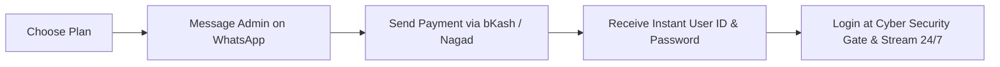

# 🎮 Country Flag Battle Royale 24/7
### The Ultimate Autonomous Esports Battle Royale Simulator for YouTube Live & TikTok (9:16 Vertical Stream)

[-00e5ff?style=for-the-badge)](https://github.com/tawhid2005/Country-flag-battle-Game)

 

**Country Flag Battle Royale 24/7** is a world-class, automated 24/7 live-streaming simulation game built specifically for content creators, gaming channels, and TikTok/YouTube Live streamers. Featuring real-time **Matter.js 2D rigid-body physics**, dual-tier high-definition vector flag rendering, copyright-safe procedural Web Audio synthesis, and dynamic spectator leaderboards — ready to broadcast straight out of the box in OBS Studio and Streamlabs.

---

## 📌 Table of Contents
1. [🌟 Highlights & Features](#-highlights--features)
2. [🚀 How to Use & Broadcast (OBS Setup Guide)](#-how-to-use--broadcast-obs-setup-guide)
3. [⚙️ Streamer Drawer & Controls](#️-streamer-drawer--controls)
4. [💎 Subscription Plans & Pricing](#-subscription-plans--pricing)
5. [🛒 How to Purchase & Activate Your License](#-how-to-purchase--activate-your-license)
6. [🔒 Cyber Security Gate & Anti-Piracy Protection](#-cyber-security-gate--anti-piracy-protection)
7. [🔍 Google Search Keywords & SEO Optimization](#-google-search-keywords--seo-optimization)
8. [❓ Frequently Asked Questions (FAQ)](#-frequently-asked-questions-faq)
9. [📞 Official Support & Contact](#-official-support--contact)

---

## 🌟 Highlights & Features

* 🎪 **High-Octane Rotating Battle Arena**: Circular battle colosseum powered by Matter.js rigid-body physics with motor-driven kinetic flippers, bouncy neon pinball bumpers, and dynamic hazard gates.
* 🏳️ **Dual-Tier Pro Flag Engine**: Procedural vector flag generator combined with official FlagCDN high-res textures for over 190+ nations worldwide.
* 🔮 **3D Glossy Championship Marbles**: Specular light glints, metallic championship rims, and country name labels for crystal-clear spectator visibility on mobile screens.
* ⚔️ **Esports 1v1 Final Showdown Stinger**: Dramatic split-screen entrance banner with flame & cyan lightning effects and sub-bass impact audio when only 2 countries remain.
* 🏆 **Royal Victory Podium Celebration**: Golden sunburst particle bursts, laurel wreath crest, 3D animated golden crown, and an automated 7-second circular intermission countdown.
* 🎵 **100% Copyright-Free Web Audio Synthesizer**: Zero risk of YouTube Content-ID strikes or stream mutes! Real-time Web Audio API synthesis produces bumper pops, kinetic bounces, heartbeat tension pulses, and victory fanfares.
* 📱 **Native 9:16 Vertical Esports HUD**: Designed from the ground up for YouTube Shorts, YouTube Vertical Live, TikTok Live, and Facebook Reels.

---

## 🚀 How to Use & Broadcast (OBS Setup Guide)

Getting your 24/7 Country Flag Battle Royale stream running in OBS Studio takes less than 2 minutes:

### Step 1: Open the Game
* **Option A (Local)**: Double-click `index.html` or run via local HTTP server (`http://localhost:8080/index.html`).
* **Option B (Hosted Web Link)**: Open your hosted GitHub Pages or online stream URL.

### Step 2: Log In Through the Cyber Security Gate
* Enter your licensed **User ID / Username** and **Password** into the Cyber Security Gate.
* Click **`⚡ UNLOCK ARENA`** to authenticate and launch the simulation.

### Step 3: Add to OBS Studio / Streamlabs
1. Open OBS Studio.
2. In the **Sources** panel, click **`+`** and choose **`Browser`**.
3. Name your source `Flag Battle Royale 24/7`.
4. Configure the Browser Source settings:
   * **URL**: Enter your local server address (e.g. `http://localhost:8080/index.html`) or web URL.
   * **Width**: `1080`
   * **Height**: `1920` (or `720` x `1280` for 720p 9:16)
   * **FPS**: `60`
   * Check: **`Control audio via OBS`**
5. Click **OK**.
6. Set your OBS Canvas resolution to **1080x1920** (Settings ➡️ Video ➡️ Base Canvas Resolution: `1080x1920`).
7. Hit **Start Streaming** on YouTube Live or TikTok Live! The game will autonomously loop rounds 24/7 without needing any manual intervention.

---

## ⚙️ Streamer Drawer & Controls

Streamers have full real-time control over the arena physics and gameplay:

| Action / Shortcut | Description |
| :--- | :--- |
| **`H` Key** | Toggle Streamer Settings Drawer (Hidden from stream HUD) |
| **⚙️ Gear Icon** | Click to open Streamer Controls Drawer |
| **Gravity Control** | Adjust gravitational pull from floaty moon physics to hyper-fast drops |
| **Arena Rotation Speed** | Speed up or slow down the central circular stadium rotation |
| **Flipper Force** | Fine-tune the kickback power of kinetic flippers |
| **Batch Size (16 / 32 / 64)** | Select how many nations battle in each round |
| **SFX Volume Slider** | Adjust game sound effects level (100% Content-ID strike safe) |
| **Subscription Status** | Displays active account details and remaining duration |

---

## 💎 Subscription Plans & Pricing

To maintain continuous 24/7 cloud sync, server maintenance, and premium updates, Country Flag Battle Royale operates on transparent, affordable subscription plans:

| Tier | Package | Duration | Price (BDT) | Features & Benefits |
| :---: | :--- | :---: | :---: | :--- |
| 🥉 | **Starter Pass** | **1 Month (30 Days)** | **99 TK** | Unlimited 24/7 streaming, full physics engine, all 190+ flags |
| 🔥 | **Popular Pass** | **2 Months (60 Days)** | **149 TK** | **Most Popular!** Complete access + priority cloud sync |
| 💎 | **Value Pass** | **4 Months (120 Days)** | **239 TK** | Best for growing channels & regular daily streamers |
| 🚀 | **Pro Pass** | **8 Months (240 Days)** | **399 TK** | High-performance long-term streaming pass |
| 👑 | **Ultimate VIP Pass**| **12 Months (365 Days)** | **499 TK** | **Best Value!** Full 1-Year unlimited license access |

---

## 🛒 How to Purchase & Activate Your License

Purchasing an access license is quick and instant:

### Simple 4-Step Activation:
1. **Choose your desired plan** from the pricing table above (e.g., 2 Months — 149 TK).
2. **Contact Master Admin on WhatsApp**:
   * 📲 **WhatsApp Number**: [`+8801711729858`](https://wa.me/8801711729858)
   * 💬 **Direct WhatsApp Chat**: [Click Here to Message Admin](https://wa.me/8801711729858?text=Hello%20Tawhid%20Bhai,%20I%20want%20to%20buy%20Country%20Flag%20Battle%20Royale%20Subscription)
3. **Make Payment**:
   * Accepted payment methods: **bKash (Personal / Send Money)**, **Nagad**, or **Rocket**.
   * Admin will provide the transaction number upon contact.
4. **Instant Delivery**:
   * Within minutes, you will receive your unique **User ID**, **Password**, and **1-Click Auto-Unlock Activation Link**.
   * Simply input them on the login gate, click **`⚡ UNLOCK ARENA`**, and start streaming immediately!

---

## 🔒 Cyber Security Gate & Anti-Piracy Protection

* **Multi-Device Cloud Authentication**: Licenses are authenticated through a high-availability cloud database with sub-second response times.
* **Device Flexibility**: Use your licensed account across your desktop PC, laptop, or mobile browser.
* **Cryptographic Anti-Tamper Signatures**: Every issued account contains a cryptographic SHA-256 signature preventing unauthorized clock manipulation or duration tampering.
* **Clean Stream HUD**: The Cyber Security Gate and Master Admin controls remain completely hidden while streaming, ensuring zero clutter on your broadcast.
* **Privacy Assurance**: All administrative security keys and master credentials remain strictly confidential to safeguard creator licenses.

---

## 🔍 Google Search Keywords & SEO Optimization

> *This repository is fully optimized to rank at the top of Google search results for streaming automation and flag battle simulators.*

### Primary Search Queries:
* **Country Flag Battle Royale 24/7**
* **YouTube Live Flag Battle Game 9:16**
* **TikTok Live Flag Game Simulator**
* **Autonomous Flag Battle Royale Stream Game**
* **24/7 Flag Elimination Game for Streamers**
* **Country Marble Battle Royale OBS Source**
* **Matter.js Flag Battle Royale Game**
* **Flag Wars Simulator for YouTube Shorts**
* **Country Flag Elimination Live Stream**
* **Automated Vertical 9:16 Live Stream Game**

### Meta Information:
* **Category**: Broadcast Gaming Software / Autonomous Livestream Simulator
* **Compatibility**: OBS Studio, Streamlabs Desktop, vMix, Google Chrome, Microsoft Edge, Mozilla Firefox, Safari
* **Target Audience**: YouTube Streamers, TikTok Gamers, Facebook Gaming Creators, Automation Channel Owners

---

## ❓ Frequently Asked Questions (FAQ)

#### Q1: Can I run this game on YouTube Live 24/7 continuously without stopping?
**Yes!** The simulator is completely autonomous. Once a round concludes with a winner, the Royal Victory Podium displays for 7 seconds and then automatically generates a fresh new round with newly randomized countries.

#### Q2: Will my YouTube or TikTok stream get copyrighted or muted?
**Never.** The game utilizes a custom procedural Web Audio API synthesizer that generates audio waves algorithmically in real-time. No pre-recorded MP3 tracks are used, guaranteeing 100% immunity from Content-ID claims.

#### Q3: Can I test this on multiple computers or mobile phones?
**Yes.** Your User ID and Password are synced via a global cloud database, allowing you to log in from any computer or mobile device.

#### Q4: How do I renew my license when my subscription expires?
Simply contact the Admin on WhatsApp at **`+8801711729858`** before or after expiration. Once payment is confirmed, your account will be instantly extended without needing to change your credentials.

---

## 📞 Official Support & Contact

For new subscriptions, renewals, custom branding, or streamer support:

* 👤 **Admin**: Tawhid (`tawhidh2005`)
* 📲 **WhatsApp**: [`+8801711729858`](https://wa.me/8801711729858)
* 💳 **Payment Methods**: bKash, Nagad, Rocket
* 🌐 **GitHub Repository**: [tawhid2005/Country-flag-battle-Game](https://github.com/tawhid2005/Country-flag-battle-Game)

Crafted with ❤️ for YouTube & TikTok 24/7 Live Streamers worldwide.

